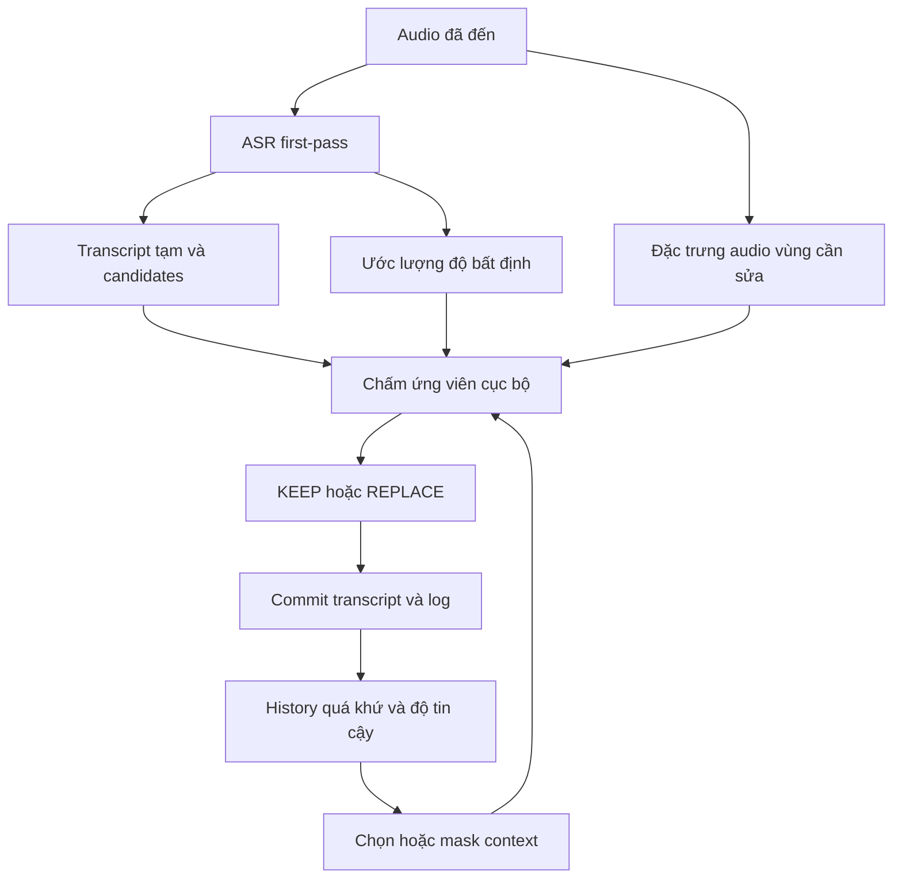

# BẢN THIẾT KẾ NGHIÊN CỨU VÀ PHÁT TRIỂN ASR VIỆT–ANH THEO NGỮ CẢNH

**Tên làm việc:** Reliability-Aware Causal Context for Vietnamese–English Streaming ASR  
**Ngày rà soát:** 13/10/2026  
**Phiên bản:** 1.0 — bản thiết kế tổng hợp; chưa phải báo cáo thực nghiệm mới  
**Phạm vi chính:** ASR tiếng Việt xen tiếng Anh, ngữ cảnh quá khứ 10–20 giây, sửa có chọn lọc và đo độ trễ streaming.  
**Phạm vi tiếp nối:** MT độc lập và kết nối ASR–MT có xử lý độ bất định; không thuộc thí nghiệm chính của phiên bản này.

> Mục tiêu là khôi phục đúng lời nói bằng âm thanh và ngữ cảnh có kiểm soát. Một câu nghe hợp lý hơn về ngữ nghĩa chưa chắc là transcript đúng hơn.

## Cách đọc và trạng thái bằng chứng

- **Đã công bố:** thông tin kiểm tra được từ paper, repository hoặc model/dataset card; có mã nguồn tham khảo `[Rxx]`.
- **Đã được người dùng/tài liệu nội bộ báo cáo:** chưa đồng nghĩa đã kiểm tra checkpoint, dữ liệu và phép tính trong repository.
- **Đề xuất:** lựa chọn thiết kế hoặc giả thuyết cần thực nghiệm; các con số kế hoạch không phải số liệu đạt được.
- **Chưa xác minh:** thiếu dữ liệu, quyền truy cập, mã nguồn, manifest hoặc báo cáo kết quả.

Bản này tổng hợp cuộc trao đổi, đối chiếu `DPL_research_proposal_ASR.pdf` và `CODEX_ASR_V5_POSTTRAIN_AUDIT_PROTOCOL.md`. Không truy cập repository Windows, không huấn luyện, không mở final TEST và không tạo số liệu thực nghiệm. Tài liệu audit V5 là yêu cầu kiểm tra, không phải kết quả kiểm tra.

## Mục lục

1. Quyết định thiết kế và mục tiêu
2. Trạng thái dự án và những phát biểu cần điều chỉnh
3. Bài toán, định nghĩa và câu hỏi nghiên cứu
4. Bằng chứng liên quan và khoảng trống có thể kiểm nghiệm
5. Bốn backbone ứng viên và cách lựa chọn
6. Chiến lược dữ liệu nhiều nguồn
7. Xây dựng tập hội thoại liên tục
8. Chia dữ liệu, chống leakage và quản lý provenance
9. Kiến trúc và cơ chế ra quyết định đề xuất
10. Huấn luyện, hiệu chuẩn và kiểm soát ngữ cảnh nhiễu
11. Baseline và ba nhóm thực nghiệm
12. Metric và quy tắc chấm công bằng
13. Thống kê, cỡ mẫu và tiêu chí kết luận
14. Ma trận ablation và kiểm nghiệm phản thực
15. Các vấn đề kỹ thuật, khoa học và điều kiện dừng
16. Lộ trình triển khai theo các cổng quyết định
17. Hợp đồng đầu ra, khả năng tái lập và cấu trúc mã nguồn
18. Giao diện dành cho MT ở giai đoạn sau
19. Checklist hoàn tất và các thí nghiệm đầu tiên
20. Tài liệu tham khảo và bản đồ bằng chứng

## 1. Quyết định thiết kế và mục tiêu

### 1.1. Mục tiêu sản phẩm

Hệ thống nhận audio liên tục và xuất transcript Việt–Anh theo thời gian. Hệ thống lưu một cửa sổ quá khứ hữu hạn, nhận biết những vị trí chưa chắc chắn và chỉ chấp nhận thay thế khi ứng viên có đủ bằng chứng.

Ví dụ mục tiêu, **không phải kết quả mô hình hiện tại**:

- Audio: “Mình vừa fix xong cái bug này.” → giữ đúng `fix`, `bug`.
- Audio: “Tối nay tôi cài game.” → không đổi `cài` thành `cày` chỉ vì lịch sử nói về chơi game.
- Audio: “Tối nay tôi cày game.” → có thể chọn `cày` khi âm thanh và lịch sử thực sự hỗ trợ.
- Lịch sử chứa tên sản phẩm sai → hệ thống không được mặc nhiên lặp tên đó ở lượt tiếp theo.

Ngữ cảnh 10–20 giây là **bộ nhớ quá khứ**, không phải yêu cầu đợi 20 giây mới xuất chữ. Chữ tạm thời được hiển thị sớm; chữ trong vùng còn được phép chỉnh sửa được ổn định theo một chính sách cố định.

### 1.2. Mục tiêu nghiên cứu

Kiểm nghiệm đồng thời ba điều kiện:

1. Context giúp giảm lỗi trên phần tiếng Anh và các từ dễ nhầm.
2. Cơ chế chọn/mask context giảm tác hại khi lịch sử có lỗi hoặc đã đổi chủ đề.
3. Lợi ích đó còn tồn tại khi tính đầy đủ chi phí suy luận và độ trễ ổn định chữ.

Không bắt đầu bằng việc cộng tất cả baseline thành một ensemble. Baseline là đối chứng để xác định phần nào tạo lợi ích. Một hệ thống cuối có thể gồm backbone và module context nhỏ, nếu tổ hợp đó có bằng chứng tốt nhất trong ngân sách triển khai.

### 1.3. Phạm vi bắt buộc và mở rộng

| Hạng mục | Trạng thái thiết kế |
|---|---|
| Một backbone đã được kiểm tra làm trục thực nghiệm | Bắt buộc |
| So sánh bốn ứng viên trên pilot DEV | Bắt buộc ở mức inference khả thi |
| Ngữ cảnh tự sinh từ quá khứ, giới hạn 10–20 giây | Bắt buộc cho kết luận streaming-context |
| KEEP/REPLACE có hiệu chuẩn và có thể từ chối sửa | Bắt buộc |
| Test tiếng Việt thông thường và câu không code-switch | Bắt buộc |
| Sửa substitution cục bộ | Phạm vi editor đầu tiên |
| Sửa insertion/deletion, viết lại toàn câu | Mở rộng riêng; không trộn vào editor substitution ban đầu |
| Fine-tune backbone | Chỉ khi pilot chứng minh thiếu candidate hoặc first-pass yếu |
| Xây backbone từ trọng số ngẫu nhiên | Chưa phù hợp để làm nhiệm vụ chính với nguồn lực/dữ liệu đã biết |
| Fusion ASR–MT | Giai đoạn sau, giao diện được chuẩn bị trước |

## 2. Trạng thái dự án và những phát biểu cần điều chỉnh

### 2.1. Các trạng thái không được gộp làm một

| Trạng thái | Những gì đã biết | Giới hạn |
|---|---|---|
| ContextASR P ban đầu | Theo mô tả: PhoWhisper-small đóng băng, context encoder âm tiết/thanh điệu, acoustic/presence heads, trie pointer, OOL và dynamic gate | Chưa kiểm tra code trong lần tổng hợp này |
| Pilot ngày 10/10 | Người dùng báo B0/P giống transcript ở 384/384 requests; WER 1,052%, CER 0,541%, entity recall 15/15 | Panel nhỏ; không phải bằng chứng hơn SOTA hoặc tổng quát hóa |
| Chi phí pilot cũ | RTF B0 0,934–1,095; P 2,069–2,554 theo báo cáo | Không suy ra realtime của bản thiết kế mới |
| Acoustic pilot | Báo cáo loss giảm 4,187 → 2,445 | Nếu đo trên DEV thì gọi DEV loss; không gọi training loss và không suy ra WER giảm |
| V5 | Tài liệu audit ghi người dùng đã xác nhận main training hoàn tất; mô tả decoder LoRA và dữ liệu mở rộng | Chưa có kết quả audit/decoded evaluation đã xác minh trong tài liệu đọc được |
| Proposal ASR–MT cũ | Đề xuất so initialization/adaptation và lỗi truyền sang MT | Là proposal offline; không tự chứng minh causal context hay streaming |

Theo snapshot trong tài liệu audit, V5 dùng VIVOS/FLEURS/VietMed và decoder LoRA. Không thay các số pilot P cũ bằng tên “kết quả V5”. Trước khi kế thừa V5, phải có matched evaluation base–V5, checkpoint hash, decoder policy và provenance hợp lệ.

### 2.2. Những điều chỉnh khoa học cần giữ xuyên suốt

1. **PhoWhisper-small là baseline phù hợp, chưa phải backbone tốt nhất cho bài toán mới.** Kích thước 244M không tự bảo đảm chạy nhanh trên máy đích [R02].
2. **Không xem PhoWhisper có tokenizer tiếng Việt riêng như một sự thật đã được chứng minh.** Kiểm tra tokenizer files, special tokens và prefix của chính checkpoint. Nếu vocab/merges giống nhau thì khác biệt hành vi không thể quy ngay cho tokenizer.
3. **RNN-T không phải bộ giải mã non-autoregressive như CTC.** Predictor của transducer phụ thuộc lịch sử nhãn; encoder streaming vẫn có thể xử lý theo chunk.
4. **Masked chunking không đồng nghĩa context masking theo độ tin cậy.** Đây là hai cơ chế khác nhau và phải có tên/thí nghiệm khác nhau.
5. **Context dài không chắc chắn gây lỗi, cũng không chắc chắn cải thiện.** Cần đo theo lượng nhiễu, độ cũ và độ liên quan.
6. **ASR score có điều kiện theo audio không phải likelihood âm học thuần.** Whisper decoder còn chứa prior ngôn ngữ. Hai điểm ASR và LM không độc lập.
7. **Oracle history không phải upper bound toán học.** Lịch sử đúng vẫn có thể làm một mô hình bias sai; đó là đối chứng có thêm thông tin chuẩn.
8. **Có CanVEC cho hội thoại Việt–Anh tự nhiên.** Khoảng trống không thể phát biểu “chưa có dữ liệu hội thoại Việt–Anh” [R12–R13].
9. **So Whisper-small với PhoWhisper-small sau LoRA/AG không đủ làm novelty độc lập.** Bảng 6 của ViMedCSS đã so các initialization này. Giá trị mới phải nằm ở câu hỏi và giao thức causal noisy-context cụ thể [R10].
10. Các dẫn chiếu mơ hồ như “Lee et al. 2024” chưa có title/DOI được xác định thì không dùng làm bằng chứng chính.

## 3. Bài toán, định nghĩa và câu hỏi nghiên cứu

### 3.1. Đầu vào và đầu ra

Tại thời điểm hệ thống đã nhận audio đến mốc \(t\):

- Audio được phép dùng: \(x_{\le t}\).
- Lịch sử \(H_t\): transcript hệ thống đã tạo cho audio quá khứ trong cửa sổ \(W\in\{0,5,10,20\}\) giây, kèm timestamp, confidence, speaker/session nếu có.
- Đầu ra: transcript tạm thời, transcript đã commit, các span sửa và trạng thái KEEP/REPLACE.
- Không được dùng reference, audio chưa đến hoặc nhãn tiếng Anh trong TEST để tạo candidate/context.

Phát biểu tổng quát:

\[
\hat y_t = f_\theta(x_{\le t},H_t;B),
\]

trong đó \(B\) là ngân sách thời gian/bộ nhớ. Với bounded lookahead, thời điểm phát chữ phải bao gồm thời gian chờ phần audio đó; không được gọi là zero-lookahead.

### 3.2. Ba loại ngữ cảnh

| Loại | Ví dụ | Vai trò |
|---|---|---|
| Acoustic context | Đặc trưng âm thanh quanh từ và cache encoder quá khứ | Phân biệt phát âm, thanh điệu, ranh giới |
| Sentence context đã quan sát | Các từ trước/sau vị trí sửa nhưng đã được nói trước thời điểm quyết định | Hiểu cú pháp và nghĩa trong đoạn đang xử lý |
| Cross-utterance history | Transcript 10–20 giây trước | Chủ đề, thuật ngữ đã nhắc, sự tiếp nối hội thoại |

Ngữ cảnh 20 giây là ngữ cảnh hội thoại cục bộ mở rộng; không nên gọi là hiểu toàn cục của cuộc hội thoại dài hàng giờ.

### 3.3. Câu hỏi nghiên cứu

**RQ1 — Context utility.** Với cùng backbone, candidate pool và chính sách streaming, lịch sử tự sinh có cải thiện nhận dạng code-switch/từ dễ nhầm so với không history và history thô không?

**RQ2 — Reliability and conflict.** Chọn/mask lịch sử theo độ tin cậy kết hợp kiểm tra audio hiện tại có giảm sửa sai khi context nhiễu hoặc mâu thuẫn âm thanh không?

**RQ3 — Accuracy–latency trade-off.** Lợi ích có còn khi so ở cùng giới hạn p90 stable-text latency, cùng tỷ lệ can thiệp và tính cả chi phí module phụ không?

**RQ4 — Transfer, mở rộng.** Hiệu quả giữ được trên người nói, thuật ngữ, miền dữ liệu hoặc backbone khác đến mức nào?

### 3.4. Giả thuyết và kết quả có thể bác bỏ

| Giả thuyết | Bằng chứng cần có | Dấu hiệu bác bỏ/giới hạn |
|---|---|---|
| H1: history hỗ trợ code-switch | Giảm CS-WER trên TEST hội thoại với history tự sinh | Chỉ cải thiện với gold history hoặc câu dựng sẵn |
| H2: reliability + audio giảm harm | Harm giảm ở cùng coverage; gain còn khi history lỗi | Giảm harm chỉ do hệ thống gần như không sửa |
| H3: cơ chế đủ nhanh | Đạt ngân sách latency định trước và không tích lũy backlog | WER tốt nhưng p90 vượt ngân sách |
| H4: lợi ích có tính chuyển giao | Lặp lại trên domain/backbone thứ hai | Chỉ tốt ở một nguồn/thuật ngữ đã thấy |

Không nhất thiết phải xác nhận cả H1–H4. Báo cáo kết quả âm tính có kiểm soát vẫn giúp quyết định hướng phát triển.

## 4. Bằng chứng liên quan và khoảng trống có thể kiểm nghiệm

### 4.1. Các nhánh liên quan

| Công trình/nguồn | Điều được hỗ trợ | Điều chưa suy ra được cho đề tài |
|---|---|---|
| Whisper, ICML 2023 [R01] | Backbone speech encoder–decoder đa ngữ | Không chứng minh streaming Việt–Anh đạt độ trễ mong muốn |
| PhoWhisper, ICLR Tiny Papers 2024 [R02] | Thích nghi Whisper cho tiếng Việt | Không chứng minh chống lịch sử sai |
| ChunkFormer, ICASSP 2025 [R03] | Xử lý long-form bằng chunk và masked batching | Cần kiểm tra checkpoint/lookahead cho online thực sự |
| Zipformer, ICLR 2024 [R04] | Encoder hiệu quả cho ASR | Paper kiến trúc không chứng nhận riêng checkpoint cộng đồng Việt Nam |
| Mask CTC, Interspeech 2020 [R06] | Mask dự đoán confidence thấp rồi dự đoán lại | Không tự giải quyết causal history Việt–Anh |
| TCPGen với Whisper/GPT-2, Interspeech 2023 [R07] | Biasing thực thể qua trie/pointer, có thể giữ backbone frozen | Không bảo đảm context sai sẽ luôn bị từ chối |
| DCTX-Conformer, 2023 [R08] | Mang biểu diễn context giữa chunk | Acoustic carry-over khác với reliability của transcript history |
| LongFNT/SLongFNT, 2024 [R09] | Kết hợp lịch sử speech/text trong non-streaming và streaming | Không chuyển nguyên kết quả sang Việt–Anh hay hardware khác |
| Peng et al., 2025 [R14] | Context masking và re-decoding dùng ngữ cảnh hai phía | Không phải bằng chứng trực tiếp cho chỉ-quá-khứ 10–20 giây |
| ViMedCSS, LREC 2026 [R10] | Benchmark medical code-switch và baseline adaptation | Không đánh giá chính cơ chế history online đề xuất |
| CanVEC, LREC 2020 [R12] | Hội thoại Việt–Anh tự nhiên đã tồn tại | Phải xác nhận audio, timestamp, quyền truy cập và domain phù hợp |
| TSPC, arXiv 2025, bản sửa 2026 [R15] | Biểu diễn phoneme là hướng liên quan trực tiếp Việt–Anh | Chưa dùng số WER của tác giả như số cùng benchmark |
| Whisper-Streaming, 2023 [R16] | Local agreement để chuyển Whisper sang xử lý liên tục | Latency của paper không phải latency trên máy nhóm |

### 4.2. Phát biểu khoảng trống phù hợp

> Trong phạm vi nguồn đã rà soát, cần thêm bằng chứng thực nghiệm về việc dùng lịch sử ASR tự sinh chỉ từ quá khứ cho hội thoại Việt–Anh, với cơ chế phân biệt độ tin cậy của lịch sử và mức phù hợp của ứng viên với audio hiện tại, đồng thời kiểm soát sửa sai và độ trễ ổn định chữ.

Đây là khoảng trống kiểm nghiệm cụ thể, không phải khẳng định chưa ai từng dùng mask, gate, semantic rescoring hoặc contextual ASR.

### 4.3. Đóng góp có thể phát triển

- **C1 — Method:** cơ chế ra quyết định KEEP/REPLACE có điều kiện theo reliability của history, độ hỗ trợ từ audio và xung đột giữa hai nguồn.
- **C2 — Protocol:** đánh giá closed-loop history tự sinh, history có nhiễu, harmful corrections và stable-text latency trên cùng stream.
- **C3 — Resource:** annotations/splits/manifest hội thoại Việt–Anh có timestamp, uncertainty và conflict cases; tùy quyền dữ liệu.
- **C4 — Evidence:** xác định khi nào context hữu ích, khi nào gây hại và khi nào candidate generator là nút thắt.

Trước khi viết “novel”, lập bảng so sánh method gần nhất theo: causal/bidirectional; text/audio history; mask ngẫu nhiên/reliability; candidate selection; reject option; latency; code-switch; noisy-history evaluation. Những ô khác nhau chưa tự chứng minh novelty, nhưng giúp xác định thí nghiệm cần làm.

## 5. Bốn backbone ứng viên và cách lựa chọn

### 5.1. Danh sách pilot

| ID | Checkpoint/nguồn | Vai trò | Điểm phải xác minh |
|---|---|---|---|
| A | `vinai/PhoWhisper-small` [R02] | Kế thừa hệ thống, baseline tiếng Việt | Streaming wrapper, prefix, N-best và scorer |
| B | `openai/whisper-small` [R01] | Đối chứng initialization đa ngữ cùng họ | Dùng cùng decoder và cấu hình với A khi so initialization |
| C | `khanhld/chunkformer-ctc-large-vie` [R03] | Đối chứng CTC/long-form; ứng viên tích hợp scorer | Lookahead, cache và đường online của đúng checkpoint |
| D | `hynt/Zipformer-30M-RNNT-Streaming-6000h` [R05] | Ứng viên streaming nhỏ | Trọng số/API cần cho candidate scoring; dữ liệu đã tiếp xúc và license |

Đây là **bốn ứng viên có lý do lựa chọn**, không phải bảng xếp hạng bốn mô hình tốt nhất tuyệt đối. Checkpoint `...RNNT-6000h` không có chữ `Streaming` phải được phân biệt với bản D. Model card của D ghi khoảng 30M tham số, có FLEURS/VietMed trong danh sách nguồn train và license CC BY-NC-ND 4.0; phải xác định phạm vi sử dụng trước khi phân phối bản thích nghi [R05].

Repository ChunkFormer có đường online và các checkpoint RNN-T streaming mới hơn; chỉ thay C bằng một checkpoint đó sau feasibility audit, lưu ID/revision cụ thể và đánh dấu đây là **thay ứng viên**, không tráo checkpoint giữa bảng kết quả [R03b].

### 5.2. Quy trình chọn backbone

1. Dùng DEV pilot chung, không xem final TEST.
2. Kiểm tra baseline WER/CS-WER, lỗi tiếng Việt và khả năng sinh candidate tốt.
3. Benchmark batch=1, model resident, cùng hardware, tính VAD/frontend/decode/rescore/queue.
4. Kiểm tra prefix invariance: giữ audio đã nhận giống nhau, thay phần audio tương lai chưa đưa vào; output trước thời điểm đó phải giữ nguyên với cấu hình xác định.
5. Chọn mô hình trên Pareto frontier: không bị mô hình khác đồng thời tốt hơn về lỗi và độ trễ trong giới hạn bộ nhớ.
6. Khóa một backbone làm core. Một backbone thứ hai dùng kiểm tra chuyển giao nếu đủ nguồn lực.

Không buộc CTC và RNN-T dùng “beam=5” với ý nghĩa tương đương Whisper: beam width không có chi phí hay không gian tìm kiếm đồng nhất giữa họ model. Thay vào đó công bố search budget và chất lượng–độ trễ của từng decoder.

### 5.3. Có nên tự xây backbone dựa trên Whisper?

Có thể sửa kiến trúc hoặc thêm module và dùng pretrained weights. Giai đoạn đầu nên ưu tiên frozen backbone + editor nhỏ để đo riêng đóng góp. Fine-tune có kiểm soát hoặc distillation là bước tiếp theo nếu cần. Train từ đầu sẽ đưa thêm các biến dữ liệu, tokenizer, optimization và compute, làm khó quy kết hiệu quả cho cơ chế context.

## 6. Chiến lược dữ liệu nhiều nguồn

### 6.1. Vai trò dữ liệu

| Nguồn | Vai trò chính | Dùng train? | Dùng đánh giá history? | Điều kiện |
|---|---|---|---|---|
| VIVOS [R17] | Retention tiếng Việt, đối chiếu benchmark | Official train sau audit | Không dùng câu rời để chứng minh hội thoại | Giữ official test; DEV tự tách từ train có thể đã được backbone thấy |
| ViMedCSS [R10–R11] | Medical code-switch, Test/Hard công khai | Chỉ train partition | Chỉ khi phục dựng continuity hợp lệ | Tách bản release thực tải với tổng trong paper |
| CanVEC [R12–R13] | Hội thoại Việt–Anh tự nhiên | Tùy split/quyền và mục tiêu ngoại miền | Có tiềm năng trực tiếp | Audio và time alignment phải thực sự được cấp |
| Hội thoại nhóm tự thu | Core causal evaluation, domain Việt Nam hiện tại | Có, chia theo speaker/session | Có | Consent, gold transcript và timestamp |
| FLEURS `vi_vn` [R18] | Test tiếng Việt ngoài VIVOS | Chỉ nếu đã chọn vai trò train | Không mặc định continuity | Audit prior exposure riêng từng model |
| VietMed [R19] | Bổ sung miền y tế | Tùy protocol | Kiểm tra audio/session trước | Không đồng nhất với ViMedCSS |
| TTS/noise augmentation | Bổ sung TRAIN, stress test có nhãn synthetic | Có | Không thay test hội thoại người thật | Không cho giọng/kịch bản synthetic trùng TEST |

Không cần lấy mọi nguồn vào TRAIN. Một thiết kế tối thiểu có thể dùng train đa nguồn nhỏ, một corpus hội thoại core, ViMedCSS để benchmark và VIVOS để retention. Số dataset nhiều không thay thế được nhãn tốt và test độc lập.

### 6.2. ViMedCSS: thống kê và tính tái lập

Card release tại thời điểm rà soát ghi [R11]:

| Split | Câu | Giờ |
|---|---:|---:|
| train | 11.832 | 24,30 |
| validation | 1.714 | 3,57 |
| test | 1.614 | 3,39 |
| hard | 658 | 1,38 |
| Tổng | 15.818 | 32,64 |

Paper ghi tổng 16.576 câu/34,57 giờ; các tổng không được coi là thay thế cho nhau [R10]. Lưu revision, IDs, checksum, số file hợp lệ và thời lượng đo lại. Không suy đoán nguyên nhân chênh lệch. Re-run baseline trên cùng release; ghi “reproduction trên release X” nếu chưa xác nhận hoàn toàn protocol gốc.

Card có video nguồn và mốc bắt đầu/kết thúc [R11]. Chỉ khảo sát continuity khi audio liên tiếp thực sự có sẵn, không có khoảng trống bị lược bỏ và quyền sử dụng phù hợp. Nếu lấy thêm audio hoặc chia lại theo video thì đó là **benchmark dẫn xuất**, không còn cùng official split để so trực tiếp số paper.

### 6.3. CanVEC: ưu tiên kiểm tra trước khi tự thu toàn bộ

CanVEC báo cáo khoảng 10 giờ, 23 hội thoại và 45 người nói song ngữ ở Canberra [R12]. Repository hướng dẫn liên hệ để lấy dữ liệu và có mẫu transcript liên tục; không có nghĩa audio đầy đủ đã sẵn sàng tải tự do [R13].

Quyết định:

- Nếu có audio, timestamp và quyền nghiên cứu: audit rồi chọn làm core hoặc external test.
- Nếu chỉ có text: dùng để hiểu hiện tượng ngôn ngữ/thiết kế annotation, không dùng như ASR test.
- Nếu truy cập chưa có: không chặn toàn dự án; triển khai pilot tự thu.
- Không đánh đồng người Việt song ngữ ở Australia với toàn bộ người dùng tại Việt Nam; cần test chuyển miền.

### 6.4. Những nguồn không tự thay thế corpus core

VIVOS là tiếng đọc từng câu [R17]. FLEURS có tiếng Việt nhưng không phải vì thế mà trở thành hội thoại code-switch. Bảng cặp ngôn ngữ của CS-FLEURS 2025 không liệt kê Việt–Anh; không mặc định dùng nó làm benchmark trực tiếp của đề tài [R20].

Ghép ngẫu nhiên các câu rời tạo stream nhân tạo chỉ phục vụ stress test kỹ thuật. Nó không tạo lịch sử hội thoại tự nhiên và phải được báo cáo riêng.

### 6.5. Training pool được đề xuất

Tổ chức ba pool: `general_vi`, `code_switch`, `continuous_conversation`. Sampling theo **thời lượng audio** và theo nguồn/người nói, không chỉ theo số câu. Chọn một mixture trong pilot rồi khóa cho so sánh core; không chạy sweep lớn trước khi có headroom.

Khi so initialization Whisper/PhoWhisper, giữ cùng mixture, số update, effective batch, augmentation, tiêu chí checkpoint và ngân sách chọn hyperparameter. Khi so correction trên cùng checkpoint, không đổi training của backbone giữa các hàng.

## 7. Xây dựng tập hội thoại liên tục

### 7.1. Nội dung cần thu

| Nhóm | Tình huống | Mục đích |
|---|---|---|
| Natural | Hội thoại công nghệ, học tập, game, đời sống | Đo hiệu quả theo tần suất lỗi thực tế |
| Ambiguity | Cặp gần âm/thanh điệu trong nhiều ngữ cảnh | Phân biệt ngữ nghĩa và audio |
| Code-switch | Từ tiếng Anh đơn, cụm nhiều từ, viết tắt, tên sản phẩm | Đo switching và khôi phục chính tả |
| Negative controls | Không tiếng Anh, không thuật ngữ liên quan trong audio | Phát hiện chèn/sửa do context |
| Topic shift | Đổi chủ đề, nhắc từ khác nghĩa, đổi người nói | Đo context cũ gây hại |
| Acoustic difficulty | Giọng vùng miền, micro khác, nhiễu vừa phải | Đánh giá robustness theo điều kiện |

Natural test giữ prevalence thực tế. Bộ hard/challenge có thể lấy nhiều câu khó hơn nhưng báo cáo riêng; không lấy WER trên bộ chủ động chọn lỗi làm WER hội thoại đại diện.

Giai đoạn đầu ưu tiên một người nói tại một thời điểm. Các đoạn overlap giữ nhãn riêng và báo cáo độ bao phủ; nếu chưa hỗ trợ diarization/overlap, giới hạn tuyên bố rõ ràng.

### 7.2. Quy mô kế hoạch, không phải đảm bảo thống kê

- **Pilot dữ liệu:** khoảng 2–3 giờ liên tục từ 12–20 người nói là mốc lập kế hoạch ban đầu, dùng để kiểm tra annotation, latency và tỷ lệ sự kiện lỗi.
- **Mở rộng:** dự toán khoảng 10–20 giờ, tăng số người nói/phiên độc lập trước khi tăng quá nhiều câu từ một người; số cuối quyết định bằng pilot và ngân sách annotation.
- Dự toán theo số English-term occurrences, baseline errors, candidate có khả năng sửa, conflict events và speaker/session độc lập, không chỉ theo giờ.
- Pilot đã dùng quyết định thiết kế không đưa vào final TEST. Không khẳng định các mốc trên đủ significance.

### 7.3. Quy trình annotation

1. Thu âm với đồng thuận, lưu session và speaker ID giả danh.
2. Tạo transcript nháp bằng công cụ hỗ trợ nếu cần; người gán nhãn phải nghe audio và sửa.
3. Người kiểm tra thứ hai rà độc lập toàn bộ CAL/TEST; các bất đồng được phân xử bởi người thứ ba hoặc phiên adjudication.
4. Giữ lời nói thực tế: từ đệm/lặp/tự sửa theo guideline đã khóa; không sửa ngữ pháp để câu “hay hơn”.
5. Gán language tags `vi/en/other/ambiguous`, span thuật ngữ, số/tên riêng và phần không nghe rõ.
6. Forced alignment chỉ tạo timestamp nháp; kiểm tra thủ công mẫu ngẫu nhiên và các vị trí dùng đo latency/challenge.
7. Không dùng chính prediction của model đang đánh giá để quyết định gold sau khi thấy kết quả.
8. Trường hợp âm thanh thực sự không phân biệt được: đánh dấu ambiguous, giữ phân tích riêng hoặc accepted variants được khóa trước; không ép gold theo ngữ nghĩa suy đoán.

Không gộp tên riêng, từ vay mượn phổ biến và chuyển mã thành một nhãn thiếu định nghĩa. Guideline cần nêu ví dụ `game`, `AI`, tên thương hiệu, phát âm Việt hóa và cách viết chấp nhận. Benchmark công khai giữ quy tắc gốc; guideline mới áp dụng corpus tự xây.

### 7.4. Schema tối thiểu

```json
{
  "sample_id": "unique_id",
  "source": "self_recorded",
  "source_revision": "release_id",
  "session_id": "session_id",
  "speaker_ids": ["speaker_id"],
  "audio_path": "relative/path.wav",
  "audio_sha256": "computed_hash",
  "sample_rate": 16000,
  "session_start_ms": 0,
  "session_end_ms": 0,
  "transcript_raw": "human_verified_text",
  "transcript_normalized": "derived_by_frozen_normalizer",
  "tokens": [
    {"text": "example", "start_ms": 0, "end_ms": 0,
     "lang": "en", "term_id": "term_id", "ambiguous": false}
  ],
  "domain": "technology",
  "recording_condition": "documented_condition",
  "overlap": false,
  "annotation_status": "adjudicated",
  "split": "assigned_after_grouping",
  "consent_or_license": "record_id"
}
```

Đây là schema minh họa, không phải một bản ghi thật. Confidence/N-best/history là **output của một run**, lưu riêng để không vô tình coi là gold input.

## 8. Chia dữ liệu, chống leakage và quản lý provenance

### 8.1. Bốn vai trò phát triển

| Partition | Được làm gì? | Không dùng làm gì? |
|---|---|---|
| TRAIN | Học model/editor; tạo confusion lexicon; fitting confidence model | Chứng nhận tổng quát hóa |
| DEV | Chọn backbone, kiến trúc, checkpoint, hyperparameter | Kết quả cuối không thiên lệch |
| CAL | Sau khi freeze model: hiệu chuẩn confidence và ngưỡng KEEP/REPLACE | Chọn lại kiến trúc sau khi nhìn CAL |
| TEST | Đánh giá cuối theo protocol đã khóa | Tối ưu ngưỡng, sửa normalizer theo output, chọn best run |

Với corpus nhỏ, có thể dùng nested group cross-validation trong phần phát triển; vẫn giữ final TEST độc lập. Không tách train/dev bằng các đoạn kề nhau trong cùng một phiên rồi gọi speaker-independent.

### 8.2. Đơn vị grouping

Tạo đồ thị liên kết bởi cùng speaker, session, video nguồn, audio trùng/gần trùng. Các thành phần liên thông nằm trong cùng partition khi yêu cầu speaker/source independence. Hội thoại nhiều người có thể nối nhiều session với nhau; phải kiểm tra trước khi chia.

- Hash file phát hiện trùng byte; fingerprint audio phát hiện bản re-encode/trim gần trùng.
- Transcript trùng là tín hiệu audit; không tự xóa mọi câu ngắn phổ biến trùng nhau.
- Các phiên bản augmentation/TTS cùng một audio hoặc kịch bản gốc phải cùng partition.
- Kiểm tra đoạn overlap theo timestamp của video, không chỉ theo tên file.
- Unseen-term split là thử nghiệm riêng, không thay thế speaker/session split.
- Corpus ngoài chỉ gọi external test nếu không dùng để training, chọn checkpoint hoặc calibration.

### 8.3. Prior exposure của pretrained models

PhoWhisper có dùng VIVOS trong fine-tuning gốc [R02]. Vì vậy DEV tự tách từ official VIVOS train có thể đã được backbone tiếp xúc, dù module mới chưa thấy. Đây không phải bằng chứng official VIVOS test bị rò rỉ; cần phân biệt rõ hai loại exposure.

Model card D nêu FLEURS và VietMed là nguồn train, nhưng phải xác minh split cụ thể trước khi kết luận test overlap [R05]. Với dữ liệu pretraining không công khai, ghi `UNKNOWN`, không mặc định `CLEAN`.

Lưu các trạng thái: `verified_disjoint`, `known_train_exposure`, `potential_overlap`, `unknown`. Fresh self-recorded TEST giúp giảm rủi ro prior exposure, nhưng vẫn phải tách khỏi dữ liệu nhóm dùng phát triển.

### 8.4. History và quyền truy cập tại inference

Chính sách chính: mỗi hệ thống chạy từ đầu phiên, tự tạo và cập nhật history. Không lấy gold transcript hoặc từ của câu sắp nói để xây bias list.

Có hai phép đo khác nhau:

- **Shared-history diagnostic:** mọi editor nhận cùng history từ một first-pass frozen; tách hiệu quả của module hiện tại khỏi phản hồi qua thời gian.
- **Closed-loop deployment:** mỗi hệ thống dùng history do chính nó đã xuất; đo đầy đủ lan truyền lỗi. Đây là kết quả chính để kết luận vận hành.

History chuẩn, history của người nói khác, history đảo thứ tự và history bị chèn lỗi là các đối chứng đã gắn nhãn. Không trộn chúng với điều kiện thực tế.

Trong ViMedCSS, một số phương pháp biasing của paper dùng danh sách thuật ngữ từ split đang decode [R10]. Nếu tái lập, mô tả đúng điều kiện đó; thí nghiệm deployment của nhóm phải có hàng riêng với danh sách/reference-blind context. Không so hai hàng có quyền truy cập thông tin khác nhau như thể cùng điều kiện.

## 9. Kiến trúc và cơ chế ra quyết định đề xuất

### 9.1. Sơ đồ mục tiêu



Vòng O → H chỉ cập nhật sau khi quyết định đã được thực hiện. Không đưa ứng viên đang xét vào history để rồi dùng history đó làm bằng chứng cho chính ứng viên.

### 9.2. Ba cơ chế mask phải phân biệt

| Cơ chế | Che cái gì? | Mục đích | Có học hay không? |
|---|---|---|---|
| Causal attention mask | Các vị trí audio/text chưa được phép quan sát | Bảo đảm causal inference | Ràng buộc kiến trúc, không phải confidence estimator |
| History reliability mask | Token/span quá khứ thiếu tin cậy hoặc không liên quan | Hạn chế mang lỗi cũ sang hiện tại | So hard rule, soft weights và learned gate |
| Selective output mask | Một số vị trí trong hypothesis hiện tại | Tạo/đánh giá khả năng sửa | Tùy editor; không tự coi là Mask CTC nguyên bản |

Random history masking trong TRAIN là augmentation. Nó là baseline cho robustness, chưa thay thế được reliability mask thích ứng tại inference.

### 9.3. History memory

Mỗi history item có: token/span text, thời điểm audio, thời điểm hiển thị/commit, confidence đã hiệu chuẩn, nguồn first-pass/editor, trạng thái đã sửa và revision ID.

Đề xuất core:

- Dùng rolling window theo **thời gian audio**, không lấy cố định N token rồi gọi là 20 giây.
- Dùng committed history làm nguồn mặc định. Uncommitted history là một ablation riêng vì dễ thay đổi.
- Giới hạn số token và cache; log tỷ lệ context bị cắt khi nói nhanh.
- Speaker/topic change có thể giảm trọng số/reset memory, nhưng detector phải được đánh giá; không đưa gold boundary vào core.
- Giữ provenance của từ đã sửa để tránh tự củng cố cùng một lỗi qua nhiều lượt.

Một soft reliability proposal:

\[
r_j=\sigma\left(f_\phi(c_j,s_j,a_j,d_j,e_j)\right),
\]

với \(c_j\): calibrated confidence; \(s_j\): độ ổn định qua các partial; \(a_j\): đặc trưng audio alignment; \(d_j\): độ cũ; \(e_j\): nguồn/đã sửa hay chưa. Không dùng nhãn đúng/sai thật tại inference.

Trong context attention, có thể thêm \(\log(r_j+\epsilon)\) vào attention logits. Đây là thiết kế để kiểm nghiệm. Một model vẫn có thể học bỏ qua hoặc lạm dụng gate; cần ablation và kiểm tra output.

### 9.4. Word uncertainty detector

Kết hợp các tín hiệu có thể lấy từ backbone:

- Confidence/posterior ở mức span và margin giữa candidates.
- Bất đồng giữa N-best hoặc giữa các lần partial decode.
- Alignment bất ổn, tỷ lệ blank phù hợp với CTC, truncation hoặc từ bị cắt ở biên chunk.
- Code-switch boundary/term features nếu có detector được huấn luyện độc lập.

Không so entropy thô giữa các tokenizer/model. Entropy CTC ở frame nhiều blank không đồng nghĩa từ đã đúng. Detector có thể tự tin sai; đánh giá recall phát hiện lỗi cùng workload phải đưa sang editor.

### 9.5. Candidate generation và headroom

Ưu tiên candidate reference-blind theo thứ tự:

1. N-best/lattice/confusion network của first-pass.
2. Confusion lexicon từ TRAIN hoặc nguồn từ vựng được khai báo trước.
3. Thuật ngữ được suy ra từ history có độ tin cậy; thêm distractors/ngoài-list trong training.
4. Candidate do semantic model đề xuất, chỉ trong nhánh mở rộng và vẫn phải được kiểm tra với audio.

Giữ hypothesis gốc trong mọi candidate set. Giới hạn top-k và số span được sửa mỗi update để khống chế độ trễ.

**Điều kiện khả thi:** nếu phần lớn từ đúng không nằm trong candidate set, một reranker dù hoàn hảo cũng không sửa được. Khi đó ưu tiên candidate generation hoặc backbone adaptation; không tăng kích thước gate để giải quyết nút thắt sai.

Oracle N-best chỉ tính sau khi candidates đã sinh xong, dùng reference để chọn ứng viên ít lỗi nhất. Báo cả raw sequence oracle và oracle sau các ràng buộc span/deadline; không dùng oracle như output triển khai.

### 9.6. Audio-conditioned candidate score

Với hai hypotheses chỉ khác một span, có thể dùng:

\[
\Delta_a = \log P_{\mathrm{ASR}}(y^{(1)}\mid x_{\le t})-
\log P_{\mathrm{ASR}}(y^{(0)}\mid x_{\le t}).
\]

Teacher-forced score chỉ dùng candidate text, audio được phép thấy và cùng prefix. Khóa EOS policy, token-length normalization và cách lấy vùng audio. Không dùng forced alignment với gold transcript của TEST để crop audio cho model; alignment từ gold chỉ được dùng offline để chấm/đo thời gian.

Với CTC, có thể dùng sequence log probability trên encoder frames hợp lệ; với RNN-T cần scorer có đúng predictor/joiner và alignment marginalization/approximation được mô tả. Điểm giữa hai họ không cộng trực tiếp nếu chưa scale/calibrate.

Audio crop quá ngắn dễ mất đồng phát âm và từ biên. Padding quanh span chỉ được lấy từ phần audio đã đến. Nếu chọn padding có lookahead thì cộng vào latency.

### 9.7. Semantic score và cơ chế KEEP/REPLACE

Semantic branch đánh giá sự phù hợp của candidate với history đã lọc và phần câu đã quan sát. Dùng một LM/text encoder hỗ trợ Việt–Anh hoặc một mô hình nhỏ học trên dữ liệu hợp lệ. Một MLM chỉ mạnh tiếng Việt không tự bảo đảm chấm được từ tiếng Anh; phải audit tokenizer và scoring trước.

Một baseline minh bạch:

\[
S(c)=\alpha\,\widetilde A(c)+\beta\,\widetilde L(c,H_t)
+\gamma\,\widetilde F(c)-\eta\,\mathrm{EditCost}(c,y_0),
\]

trong đó \(A\) là audio-conditioned ASR score, \(L\) là semantic score, \(F\) là phonetic compatibility tùy chọn. Các dấu ngã chỉ điểm đã được chuẩn hóa bằng TRAIN/DEV, không dùng TEST.

Core learned decision có thể bắt đầu bằng logistic regression/MLP nhỏ nhận:

\[
v_i=[\Delta_a,\Delta_s,u_i,r(H_t),\text{alignment},
\text{length},\text{candidate source},\text{conflict flags}].
\]

Học xác suất một edit cải thiện hoặc gây hại; sau đó hiệu chuẩn và đặt ngưỡng trên CAL. Chọn REPLACE chỉ khi lợi ích dự đoán đủ lớn so với nguy cơ harm và còn trong deadline. Khi thiếu bằng chứng, KEEP.

Không buộc trọng số context tăng đơn điệu theo entropy: âm thanh quá nhiễu có thể làm cả semantic correction và phonetic verification không đáng tin. Mô hình phải có lựa chọn từ chối sửa.

Nếu dùng công thức trộn \(p=(1-g)p_0+gp_c\), hai phân phối phải có cùng không gian nhãn và cùng bước giải mã. Không trộn trực tiếp CTC frame posterior với phân phối word-level hoặc token của tokenizer khác.

### 9.8. Commit và deadline

- `partial`: có thể sửa trong một cửa sổ hữu hạn.
- `committed`: không được âm thầm thay đổi sau commit trong điều kiện core.
- Rescorer quá deadline → giữ first-pass; log timeout và tính trong chất lượng cuối.
- Khi queue tăng: bỏ bớt công việc rescoring theo policy khóa trước, không xử lý audio tương lai nhanh hơn tốc độ đến rồi báo realtime.
- Lưu `audio_end`, `first_emit`, `last_revision`, `commit` cho từng span có thể align.

Độ dài history và độ dài vùng được chỉnh sửa là hai tham số khác nhau. Có thể dùng history 20 giây nhưng chỉ sửa phần mới chưa commit.

## 10. Huấn luyện, hiệu chuẩn và kiểm soát ngữ cảnh nhiễu

### 10.1. Tạo dữ liệu cho editor

1. Freeze backbone/checkpoint và decoding policy cho một vòng thí nghiệm.
2. Chạy ASR trên dữ liệu TRAIN dành cho editor theo thứ tự phiên để thu lỗi tự nhiên.
3. Nếu backbone đã fine-tune trên cùng audio, ưu tiên held-out training subset hoặc out-of-fold hypotheses để giảm phân phối lỗi quá dễ. Ghi giới hạn với pretrained exposure không biết.
4. Sinh candidates không dùng reference.
5. Sau đó mới dùng reference để gán beneficial/harmful/neutral cho từng edit.
6. Giữ cả KEEP, câu đúng hoàn toàn, lỗi không sửa được, distractor terms và history sai.

Không huấn luyện editor chỉ trên các câu baseline sai: lúc triển khai nhiều câu đúng, mô hình như vậy dễ over-correct.

Nếu deployment đưa corrected output trở lại memory, training chỉ dùng first-pass history vẫn có distribution shift. Sau baseline đầu tiên, có thể sinh thêm rollout trên TRAIN bằng một phiên bản editor đã freeze, giữ nhãn provenance và huấn luyện phiên bản tiếp theo. Không cập nhật weights trong TEST; không xem rollout tự sinh là ground truth.

### 10.2. Augmentation cho history

| Điều kiện TRAIN | Công dụng | Giới hạn |
|---|---|---|
| ASR-generated history tự nhiên | Phù hợp deployment | Có thể phụ thuộc một backbone |
| Random token/span masking | Baseline robustness đơn giản | Không mô phỏng đầy đủ lỗi ASR |
| Confusion-based substitution | Lỗi gần âm, tên riêng, từ Anh bị Việt hóa | Lexicon chỉ từ TRAIN; ghi synthetic |
| Drop/repeat history spans | Mất từ, lặp từ | Tần suất cần dựa trên lỗi quan sát |
| Topic-mismatched history | Học từ chối context không liên quan | Không dùng nội dung từ TEST |
| Context dropout hoàn toàn | Bảo đảm có thể xử lý không context | Không chứng minh gate đã được hiệu chuẩn |

Gold history có thể dùng trong training như một điều kiện, nhưng không được là nguồn duy nhất. Kết quả chính luôn dùng lịch sử ASR tự sinh.

### 10.3. Loss khởi đầu

Đề xuất khởi đầu đơn giản:

\[
\mathcal L = \mathcal L_{\mathrm{candidate\ ranking}}
+\lambda_{\mathrm{harm}}\mathcal L_{\mathrm{harm\ prediction}}
+\lambda_{\mathrm{keep}}\mathcal L_{\mathrm{keep}}.
\]

Chọn nhãn candidate tốt nhất trong pool bao gồm KEEP, với tie-break ưu tiên ít edit. \(\mathcal L_{\mathrm{keep}}\) phạt thay đổi trên các vị trí đã đúng. Loss này chỉ là inductive bias, không phải bảo đảm không sửa sai.

Chỉ bổ sung phonetic contrastive loss/CTC phụ hoặc reliability supervision khi đã xác định baseline còn lỗi nào cần chúng. Hệ số loss chọn trên DEV, không đặt theo WER cuối của TEST.

### 10.4. Calibration

- Freeze model rồi fit confidence calibrator và ngưỡng trên CAL.
- Kiểm tra reliability diagram/Brier score hoặc ECE như metric chẩn đoán, không thay WER.
- Chọn operating point theo harm budget và latency budget được xác định trước.
- So sánh thêm đường gain–harm–coverage thay vì chỉ một threshold.
- Nếu CAL thiếu code-switch/conflict thì chưa thể chứng nhận operating point cho các nhóm đó.
- Thay checkpoint/candidate generator/history policy có thể làm calibration cũ không còn phù hợp; version hóa và hiệu chuẩn lại bằng dữ liệu phát triển hợp lệ.

## 11. Baseline và ba nhóm thực nghiệm

### 11.1. Track A — Đo riêng đóng góp correction/context

Giữ một checkpoint ASR, first-pass hypotheses, candidates, decoder, audio budget và source history chung khi đo diagnostic. Sau đó chạy closed-loop với cùng initial settings.

| ID | Phương pháp | Câu hỏi |
|---|---|---|
| A0 | Không sửa, không history editor | Mốc gốc |
| A1 | Rerank chỉ bằng audio-conditioned score | Có cần semantic context không? |
| A2 | Semantic-only rerank trên cùng candidate pool | Ngữ nghĩa tự gây harm bao nhiêu? |
| A3 | Audio + semantics, history thô | Lợi ích kết hợp trước reliability |
| A4 | A3 + confidence threshold đơn giản | Learned gate có hơn rule đủ mạnh không? |
| A5 | A3 + random-mask training | Reliability có hơn augmentation đơn giản không? |
| P1 | A3 + reliability mask/gate + KEEP/REPLACE | Phương pháp core |
| P2 | P1 + phonetic branch | Chỉ bổ sung nếu headroom cho thấy cần |

Native Whisper history prompting hoặc trie biasing thay đổi first-pass và candidate set, nên không đặt như một ablation cô lập của Track A. Đưa chúng vào Track B với đúng mô tả.

### 11.2. Track B — So hệ thống hoàn chỉnh

So các pipeline trên cùng test stream:

- Backbone không cross-utterance history.
- Native history prompting cho họ Whisper nếu hỗ trợ.
- Contextual trie/shallow fusion hoặc TCPGen, với quyền thông tin context tương đương.
- Two-pass rescoring chuẩn có ngưỡng confidence.
- Hệ thống đề xuất.

Backbone khác nhau có training data, tokenizer và search algorithm khác nhau. Đây là so sánh **hệ thống**, không dùng để kết luận module context riêng lẻ tạo toàn bộ chênh lệch.

Offline/full-context có thể được báo cáo làm tham chiếu accuracy nhưng tách khỏi causal streaming leaderboard. So thêm tại ngân sách latency tương đương thay vì chỉ cùng chunk size.

### 11.3. Track C — Tái lập và đối chiếu benchmark công khai

Giữ official ViMedCSS Test/Hard, official VIVOS test và các test đã chọn. Với utterance rời, đánh giá ASR/correction trong utterance; không tự tạo history kề nhau từ thứ tự file.

Mốc công bố trong ViMedCSS, đơn vị % [R10]:

| Model/setting | Test WER | Test CS-WER | Hard WER | Hard CS-WER |
|---|---:|---:|---:|---:|
| PhoWhisper-small frozen | 36,31 | 62,55 | 46,27 | 66,01 |
| PhoWhisper-small + LoRA | 27,13 | 30,26 | 37,27 | 60,71 |
| PhoWhisper-small + AG | 23,67 | 19,50 | 33,73 | 57,29 |

Các số trên là số tác giả, không phải kết quả nhóm, không dùng so trực tiếp với WER 1,052% trên panel cũ. Trong báo cáo của nhóm, cột `reported_by_authors` và `rerun_by_us` phải tách riêng.

### 11.4. Điều kiện công bằng phải công bố

| Yếu tố | Cách kiểm soát |
|---|---|
| Dữ liệu | Cùng IDs/audio; cùng exclusion list và split revision |
| Chuẩn hóa | Một normalizer/scorer cho toàn bộ hàng cùng benchmark |
| Thông tin được xem | Cùng thời điểm audio, history source, external lexicon và lookahead |
| Adaptation | Tách pretrained-only và adapted; khai báo dữ liệu/compute |
| Hyperparameter search | Budget tương đương, mọi selection trên DEV |
| Decoder | Cùng họ thì cố định cấu hình khi đo module; khác họ công bố search budget |
| Coverage | So harm ở cùng tỷ lệ edit; báo operating point triển khai riêng |
| Runtime | Cùng hardware, precision, batch, concurrency, warmup và frontend |
| Timeout/failure | Không âm thầm bỏ các mẫu khó hoặc run bị timeout |
| Reference variants | Chốt trước khi đọc prediction TEST |

## 12. Metric và quy tắc chấm công bằng

### 12.1. WER/CER và đơn vị tiếng Việt

\[
\mathrm{WER}=\frac{S+D+I}{N},\qquad
\Delta\mathrm{WER}=\mathrm{WER}_{P}-\mathrm{WER}_{B}.
\]

Âm tiết và từ tiếng Việt không luôn trùng nhau. Báo đúng tên:

- `whitespace-normalized WER` hoặc `syllable-oriented error rate` nếu tách theo khoảng trắng; trong câu mixed đây còn chứa English words.
- `word-segmented WER` chỉ khi segmenter/version và từ điển được khóa, áp dụng cùng cách cho reference/hypothesis.
- CER với quy tắc Unicode, khoảng trắng và dấu câu rõ ràng; không bỏ dấu tiếng Việt để làm đẹp số.

Báo raw S/D/I/N và WER gộp bằng tổng lỗi/tổng đơn vị, không lấy trung bình đơn giản WER từng câu rồi gọi corpus WER. Với N=0 ở silence/no-speech, báo insertion trên phút silence riêng, không chia cho 0.

### 12.2. Code-switch và thuật ngữ

- Trên benchmark công khai, ưu tiên đúng official scorer. Nếu không có code hoặc định nghĩa thiếu chi tiết, ghi `reimplementation` và công bố sai khác; không gọi exact reproduction.
- Trên corpus mới, align toàn bộ chuỗi trước, gán S/D theo language tag của reference. Quy tắc gán insertion ở ranh giới phải deterministic và được công bố.
- Không bỏ từ tiếng Việt rồi align hai chuỗi tiếng Anh độc lập: cách đó có thể khớp sai các lần lặp từ và che mất vị trí lỗi.
- Báo English-term recall theo occurrence, có precision hoặc false term insertion để phạt đoán thêm. Một từ xuất hiện hai lần là hai occurrences.
- Approved spelling variants chỉ từ guideline/TRAIN/DEV trước TEST; không tự thêm variant sau khi thấy output tốt cho model mình.
- Báo riêng thuật ngữ hiếm/chưa thấy, viết tắt, từ vay mượn và tên riêng nếu taxonomy cho phép.

CS-WER giữa paper khác nhau có thể khác cách đánh dấu/gán insertion. Cùng tên metric chưa đủ để cùng protocol.

### 12.3. Metrics cho editor substitution

Khóa đơn vị edit là **một span thay thế**, có thể gồm nhiều subword. Với mỗi edit đơn lẻ trên hypothesis gốc, tính thay đổi edit distance so reference trên vùng evaluation đã khóa:

- Beneficial: số lỗi giảm.
- Harmful: số lỗi tăng.
- Neutral: số lỗi không đổi, dù mặt chữ thay đổi.

\[
\mathrm{EditPrecision}=\frac{\#\mathrm{beneficial\ edits}}{\#\mathrm{accepted\ edits}},
\qquad
\mathrm{Coverage}=\frac{\#\mathrm{edited\ eligible\ spans}}{\#\mathrm{eligible\ spans}}.
\]

Báo thêm tỷ lệ trên toàn bộ reference units/utterances để detector không thể làm mẫu số eligible nhỏ tùy ý. Nếu không edit, precision là N/A, không ghi 100%.

False Correction Rate cho core substitution:

\[
\mathrm{FCR}=\frac{\#\{\text{reference units baseline đúng, final thành sai}\}}
{\#\{\text{reference units baseline đúng}\}}.
\]

FCR không đếm đủ mọi insertion mới. Vì vậy phải báo thêm `new insertion count`, harmed utterances, beneficial/harmful edit counts và final WER. Khi cho phép nhiều edit, các tương tác alignment có thể làm tổng delta edit đơn lẻ khác delta cuối; báo cả hai và dùng final WER làm chất lượng chuỗi chính.

### 12.4. Streaming latency và ổn định chữ

Với một reference word/span kết thúc ở thời điểm \(e_i\):

\[
L_i^{\mathrm{first}}=t_i^{\mathrm{first\ emit}}-e_i,
\qquad
L_i^{\mathrm{commit}}=t_i^{\mathrm{commit}}-e_i.
\]

Phân biệt `commit latency` theo tín hiệu commit thực và `last-revision latency` đo hồi cứu. Nếu hệ thống không có tín hiệu commit, không gọi lần chữ cuối cùng tình cờ không đổi là cam kết online.

Định nghĩa từ-kết-thúc đến chữ-hiển-thị phù hợp với user-perceived latency trong tài liệu CAIMAN-ASR [R21]. Với đề tài có editor, bổ sung commit/last-revision là cần thiết.

| Metric runtime | Báo cáo |
|---|---|
| First-text latency | p50/p90, số span đo được |
| Stable/commit latency | p50/p90; p99 khi có đủ mẫu; định nghĩa chính xác |
| Revision burden | Số lần thay đổi token hoặc revision events/phút |
| RTF compute | Tổng thời gian xử lý hệ thống / thời lượng audio; nêu idle/network có tính hay không |
| Backlog | Queue delay theo thời gian, cực đại và cuối phiên |
| Memory | Peak RAM/VRAM, cache growth |
| Throughput | Số stream đồng thời ở cùng quality/latency policy nếu đo |

Không lấy wall-clock live replay chia thời lượng rồi gọi compute RTF: nếu chủ động phát audio tốc độ 1×, tỷ lệ đó gần 1 do chờ đầu vào. Đo compute time riêng, latency từ event timestamps và backlog riêng.

Latency chỉ trên các từ nhận đúng có thể thiên lệch về từ dễ. Báo tỷ lệ từ align/đo được, deleted/unemitted words, và quy tắc xử lý từ nhận sai. Lưu latency âm do model dự đoán trước khi từ kết thúc; không âm thầm clamp để thay phân phối.

### 12.5. Primary endpoints đề xuất

**Chính:** CS-WER trên natural conversational TEST trong closed-loop ASR-generated history, dưới ngân sách p90 commit latency đã khóa.

**Ràng buộc:** overall WER không suy giảm quá margin đã định; FCR/harm trong giới hạn đã định; retention tiếng Việt; không backlog tăng mất kiểm soát.

**Phụ:** CER, N-WER theo benchmark, term recall/precision, ambiguous-word accuracy, edit precision, candidate oracle, calibration, memory.

Không tự đặt margin “2 điểm %” chỉ vì proposal cũ từng dùng cho bài toán khác. Margin mới phải dựa trên ứng dụng, baseline DEV và độ chính xác thống kê của CAL; khóa trước TEST.

## 13. Thống kê, cỡ mẫu và tiêu chí kết luận

### 13.1. Đơn vị độc lập

Các từ trong một câu và câu trong cùng phiên không độc lập. Dùng paired cluster bootstrap ở mức speaker/session hoặc connected component đã chia dữ liệu. Mỗi bootstrap replicate dùng **cùng cluster được lấy mẫu cho cả baseline và proposed**, rồi tính lại metric bằng raw counts.

Nếu quá ít clusters, CI có thể không ổn định; công bố số clusters và giới hạn. Nhiều nghìn từ từ vài người nói không tương đương nhiều nghìn quan sát độc lập.

Đề xuất 2.000 bootstrap resamples cho báo cáo chính, kiểm tra độ ổn định số học nếu endpoint sát ngưỡng; đây là cấu hình protocol, không đảm bảo đủ power.

### 13.2. Hiệu quả, non-inferiority và nhiều phép thử

- Với metric lỗi, improvement cần CI của paired delta hỗ trợ chiều giảm, kèm effect size thực tế.
- Không có significance không đồng nghĩa hai phương pháp tương đương.
- Non-inferiority dùng margin \(\delta\) đã định và upper confidence bound phù hợp; ghi loại CI/kiểm định trước.
- Chọn một primary contrast, ví dụ P1 vs A4. Các hàng còn lại là secondary/ablation; nếu kết luận xác nhận trên nhiều phép thử thì điều chỉnh multiplicity hoặc dùng thứ tự kiểm định đã định.
- Report absolute percentage-point change và relative error reduction; luôn có số lỗi thô để tránh phóng đại cải thiện nhỏ.
- Bootstrap trên một seed chỉ phản ánh bất định test sampling, không bao phủ training randomness. Nếu khả thi, core learned modules chạy ít nhất ba seed và công bố từng seed; một seed phải ghi exploratory về training variation.

### 13.3. Xác định cỡ mẫu sau pilot

Quy trình ưu tiên:

1. Ước lượng baseline error rate, số English occurrences và beneficial/harmful discordances theo session.
2. Định nghĩa mức cải thiện nhỏ nhất đáng quan tâm và harm budget.
3. Mô phỏng lấy mẫu session/speaker từ pilot để dự toán độ rộng CI ở các quy mô thu thêm.
4. Tăng người nói/phiên ở các nhóm ít dữ liệu; không chỉ tăng số từ của người đã có nhiều.
5. Khóa kế hoạch cuối trước final TEST.

Không thấy harm trong một mẫu nhỏ không chứng minh an toàn tuyệt đối. Quy tắc gần đúng \(3/n\) cho upper bound khi zero event chỉ phù hợp quan sát độc lập dưới giả định đơn giản; không dùng trực tiếp hàng nghìn token tương quan để chứng nhận FCR thấp.

### 13.4. Reporting khi dữ liệu thiếu

Nếu không đủ events hoặc CI quá rộng, kết luận “chưa đủ bằng chứng ở cỡ mẫu hiện tại”. Nếu oracle headroom gần bằng 0 trên một panel, kết luận panel chưa đủ khả năng phân biệt phương pháp; không suy ra context luôn vô ích.

## 14. Ma trận ablation và kiểm nghiệm phản thực

Không chạy tích Descartes của mọi backbone × history × mask × noise × seed. Dùng thiết kế tuần tự để giải quyết từng câu hỏi.

### 14.1. Thứ tự ưu tiên

| Thí nghiệm | Giữ cố định | Thay đổi | Cần trả lời |
|---|---|---|---|
| E0 — Backbone pilot | DEV/audio/runtime harness | Bốn candidates | Backbone nào khả thi? |
| E1 — Candidate headroom | Một backbone/decoder | top-k và span guards | Có đủ candidate sửa được? |
| E2 — History utility | Candidate pool/editor đơn giản | 0/5/10/20 giây | History có ích trước khi học gate? |
| E3 — Source of evidence | Candidate pool/coverage | audio-only, semantic-only, kết hợp | Thành phần nào giảm lỗi/gây harm? |
| E4 — Reliability | Core scoring | raw, hard mask, random training mask, learned soft mask | Cơ chế đề xuất có hơn baseline đơn giản? |
| E5 — Noisy history | Current audio và candidates | natural/gold/corrupted/mismatched history | Có từ chối context sai không? |
| E6 — Closed-loop | Cùng stream/hardware | history riêng từng hệ thống | Lỗi có lan truyền và kéo dài không? |
| E7 — Transfer | Method đã khóa | Domain hoặc backbone thứ hai | Hiệu quả tổng quát hóa đến đâu? |

### 14.2. Cặp kiểm nghiệm conflict

Tạo ma trận 2×2 về audio evidence và history relevance bằng dữ liệu hợp lệ, có nhãn diagnostic:

| Audio | History | Mong muốn |
|---|---|---|
| Rõ | Đúng/liên quan | Giữ hoặc sửa theo lời nói |
| Rõ | Sai/mâu thuẫn | Không để lịch sử lấn át audio |
| Khó | Đúng/liên quan | Có thể hưởng lợi từ context |
| Khó | Sai/mâu thuẫn | Tăng KEEP/abstain, không đoán tự tin |

Những cặp nhân tạo không dùng để ước lượng prevalence trong tự nhiên. Chúng kiểm tra cơ chế; natural TEST kiểm tra lợi ích thực.

### 14.3. Kiểm tra lỗi tự củng cố

Gắn `origin_edit_id` cho từ sửa đi vào history. Với một edit sai, đo các occurrences tiếp theo liên quan: lỗi có tái xuất hiện, bị từ chối hay tự phục hồi. Báo error persistence theo thời gian/occurrence và đối chiếu với no-history trên cùng phiên.

So riêng history từ first-pass và history từ corrected output để biết cải thiện trước mắt có làm memory dài hạn xấu hơn không.

### 14.4. Kiểm tra causal và latency

- Thay audio tương lai chưa được đưa vào, kiểm tra output prefix.
- Audit cả frontend: chuẩn hóa đặc trưng theo toàn file, VAD offline, timestamp alignment hoặc cache chứa future frames đều có thể làm mất tính causal dù attention mask đúng.
- Thêm độ trễ rescorer giả lập, kiểm tra fallback/commit và số mẫu timeout.
- Chạy phiên đủ dài để thấy cache/backlog tăng; không chỉ benchmark các đoạn 10 giây.
- Tính p90 trên whole pipeline, không lấy riêng thời gian neural forward.
- Batch offline dùng để đo throughput phải có nhãn khác với streaming batch=1.

## 15. Các vấn đề kỹ thuật, khoa học và điều kiện dừng

| Vấn đề | Tại sao ảnh hưởng kết luận? | Phép kiểm tra/quyết định |
|---|---|---|
| Panel quá dễ | Hầu như không có lỗi để sửa | Đo error counts/oracle; mở rộng DEV khó hợp lệ |
| Không có continuous audio | Không kiểm tra được history thật | CanVEC access audit hoặc tự thu; hạn chế claim nếu chỉ có câu rời |
| Gold/reference lọt vào context | Tạo lợi ích không khả thi khi deploy | Tách inference schema khỏi labels; trace nguồn candidate/history |
| Gate luôn đóng | Hệ thống giống baseline | Đo gate distribution, edit coverage, ablation forced-open chỉ trên DEV |
| Gate luôn mở | Context lấn át audio | Negative/mismatched history và harm–coverage curve |
| Từ đúng ngoài candidate set | Reranker không thể phục hồi | Candidate oracle; quyết định thích nghi backbone/generator |
| Confidence tự tin sai | Mask giữ lại lỗi quá khứ | Calibration và lỗi theo confidence bins |
| Hard mask xóa từ hiếm hữu ích | Mất chính thông tin muốn tận dụng | Soft mask vs hard mask ở cùng budget |
| Semantic scorer ưu tiên câu phổ biến | Sửa mất ý người nói | Conflict audio–history và clean-audio controls |
| ASR/LM scores đếm prior hai lần | Trọng số có thể bias ngôn ngữ | Audio-only/semantic-only/combined ablation và calibration |
| Tokenizer khác/fragmentation | So log-prob không công bằng | Kiểm tra vocab; score normalization; không suy đoán từ tên model |
| OOV tiếng Anh trong CTC/RNN-T | Vocab/candidate bottleneck | Audit token coverage trước thêm semantic network |
| Word timing sai | Latency và audio crop sai | Human alignment audit; báo sai số timestamp |
| Speaker/topic thay đổi | History không còn liên quan | Natural topic shifts và reset/decay ablation |
| Silent/no-speech hallucination | WER thông thường có thể bỏ sót | Insertion/phút silence; fixed VAD policy |
| Prior exposure | DEV/test tưởng mới có thể đã được model thấy | Provenance matrix và fresh test |
| Medical-only | Không đại diện game/công nghệ/đời sống | Natural core và external domain riêng |
| Data/model access hạn chế | Không tái lập hoặc không phân phối được | Audit quyền truy cập; baseline thay thế có ghi lý do |
| ONNX-only/incomplete scoring API | Không lấy được N-best/log-prob cần thiết | Feasibility spike trước chọn backbone |
| Quá nhiều experiment | Tốn compute, khó quy kết | Giữ core tối thiểu; mở rộng sau gate |
| TEST bị dùng nhiều lần | Kết luận ngày càng thiên lệch | Test ledger; đổi protocol → cần test mới cho claim xác nhận |

### Điều kiện dừng hoặc đổi hướng

- **Không có history utility trên DEV đủ khó và có candidate headroom:** thu hẹp về word correction dùng local audio/câu; không ép một module history chỉ để giữ ý tưởng.
- **Có utility với gold nhưng không với ASR history:** tập trung reliability và training mismatch; chưa tuyên bố deployment tốt.
- **Candidate headroom thấp:** ưu tiên ASR adaptation hoặc candidate generation.
- **Rule/logistic baseline đã ngang learned model:** giữ baseline đơn giản hoặc đổi câu hỏi; không tăng độ phức tạp chỉ vì muốn có network mới.
- **Harm giảm nhưng coverage gần 0:** chưa chứng minh sửa tốt; so lại ở cùng coverage.
- **WER giảm nhưng latency vượt budget:** kết luận trade-off; tìm cấu hình Pareto hoặc chuyển mục tiêu near-real-time đã nêu rõ.
- **Không có continuous test hợp lệ:** chỉ kết luận utterance-level ASR; chưa kết luận causal context.

## 16. Lộ trình triển khai theo các cổng quyết định

Thời lượng dưới đây là dự toán tổ chức, không cam kết tốc độ training. Data annotation/access có thể là đường găng.

| Giai đoạn | Công việc | Output | Cổng quyết định |
|---|---|---|---|
| G0 — Audit hiện trạng | Đọc kết quả V5 nếu có; xác minh matched base/V5; kiểm tra manifest | Baseline được xác nhận hoặc danh sách blocker | Không chọn V5 chỉ vì training đã hoàn tất |
| G1 — Data feasibility | Audit ViMedCSS release; CanVEC access; thiết kế self-recorded pilot; licenses | Data registry, annotation guideline, split strategy | Có dữ liệu phù hợp causal evaluation? |
| G2 — Scoring/runtime harness | Normalizer, metric tests, event log, streaming replay | Harness tái lập | Causality và latency measurement hợp lệ? |
| G3 — Backbone/headroom pilot | 4 inference candidates khả thi; candidate oracle; lỗi theo nhóm | Pilot table và chọn 1 backbone | Candidate coverage và compute đủ? |
| G4 — Baseline context | A0–A4, history lengths, shared-history diagnostic | Utility/harm/coverage curves | Context thật sự có ích hơn không history? |
| G5 — Core method | Reliability mask/gate nhỏ; noisy-history training | Model/config và ablation trên DEV | Hơn baseline đơn giản, không chỉ giảm edit? |
| G6 — Freeze + CAL | Chốt model, scorer, margins, budgets; calibration | Frozen protocol và thresholds | CAL đủ, không thay architecture sau CAL? |
| G7 — Final evaluation | Public tests + conversational closed-loop + challenge đã khóa | Raw predictions, metrics, CI, errors | Đủ điều kiện cho từng claim? |
| G8 — Demo/release | API streaming, docs, reproducibility bundle | Demo và báo cáo | Quyền phân phối, limitations rõ ràng |

Có thể tổ chức G0–G3 trong khoảng 2–3 tuần đầu nếu data access thuận lợi; G4–G6 vài tuần tiếp theo. Không dùng lịch để bỏ qua cổng dữ liệu hoặc chuyển DEV cũ thành final TEST.

### 16.1. Cấu hình tối thiểu để bắt đầu

- Một backbone đã freeze, tối đa 5 candidates ban đầu; đây là hyperparameter pilot, không phải mức tối ưu đã biết.
- Một editor cục bộ, một text scorer nhỏ/frozen nếu khả thi, cached encoder features.
- Chỉ substitution một span mỗi quyết định đầu tiên; mở rộng nhiều span sau khi log/alignment đúng.
- Context 0/10/20 giây trong screening; thêm 5 giây khi cần phân giải trade-off.
- Một seed cho feasibility; tăng seed cho learned core khi quyết định tiếp tục.
- Benchmark trên đúng GPU/CPU thực tế của nhóm, ghi model phần cứng và VRAM từ máy; không mặc định RTX 4050/4060 hoặc A100 dựa trên thí nghiệm khác.

### 16.2. Những phần kế thừa từ P/V5

| Thành phần hiện có | Có thể kế thừa | Điều kiện |
|---|---|---|
| Loader và normalization | Có | Audit audio, split, Unicode và scoring unit |
| PhoWhisper wrapper/LoRA V5 | Có | Matched decoded evaluation hợp lệ |
| Trie pointer/catalog | Là baseline hoặc candidate source | Không dùng test-derived list trong deployment track |
| Phonetic onset/rime/tone | Là feature ablation tiếng Việt | Cần thiết kế riêng cho English; không áp luật Việt lên mọi token |
| Presence/acoustic scorer | Có thể làm feature | Kiểm tra score local vs global và gradient/ablation |
| Gate hiện tại | Có thể dùng làm đối chứng | Không giả định gate collapse đã giải quyết |
| MT code | Giữ interface cho giai đoạn sau | Không đưa MT metrics vào primary ASR conclusions |

## 17. Hợp đồng đầu ra, khả năng tái lập và cấu trúc mã nguồn

### 17.1. Artifacts bắt buộc

| Artifact đề xuất | Nội dung |
|---|---|
| `data_registry.json` | Source URL/revision, license, acquired hours/counts, file hashes |
| `split_manifest.jsonl` | IDs, groups, split và lý do loại mẫu |
| `annotation_guidelines.md` | Verbatim rules, language tags, ambiguous spans, variants |
| `provenance_audit.md` | Exposure/overlap verified và unknown |
| `evaluation_protocol.yaml` | Normalizer, metrics, decoder, history/lookahead, margins, latency budgets |
| `baseline_pilot.csv` | DEV-only backbone/candidate/runtime results |
| `predictions.jsonl` | Full outputs cho từng mẫu/run; failures giữ lại |
| `stream_events.jsonl` | Audio arrival, partial, edit, commit, timeout, history updates |
| `edit_audit.csv` | Candidate source, scores, decision, hậu kiểm benefit/harm |
| `metrics.json` | Raw counts, metrics, denominator, bootstrap setup |
| `results_report.md` | Kết luận theo RQ, CI, error cases, limitations |
| `model_card.md` | Intended use, data, operating point, runtime, known failures |

Đây là các tên output đề xuất cho giai đoạn triển khai, chưa phải file đã tạo trong lần tổng hợp này.

### 17.2. Giao diện prediction/event

```json
{
  "run_id": "unique_run",
  "session_id": "session_id",
  "audio_received_until_ms": 0,
  "hypothesis_version": 0,
  "partial_text": "...",
  "committed_text": "...",
  "edits": [
    {"span_id": "span_id", "before": "...", "after": "...",
     "decision": "KEEP_OR_REPLACE", "candidate_source": "nbest",
     "score_audio_delta": 0.0, "score_context_delta": 0.0,
     "p_benefit": 0.0, "p_harm": 0.0, "deadline_met": true}
  ],
  "history_policy": "committed_past_20s",
  "history_source": "self_generated",
  "timing": {"emit_ms": 0, "commit_ms": 0, "queue_ms": 0}
}
```

Log minh họa này không chứa gold transcript trong input runtime. Gold chỉ nối vào scoring stage bằng sample ID sau generation.

### 17.3. Cấu trúc modules đề xuất

```text
project/
  configs/             # experiment và frozen evaluation policies
  data/                # manifests; raw data theo quyền sử dụng
  src/asr/             # adapters cho Whisper/CTC/RNN-T
  src/streaming/       # audio clock, cache, event loop, commit
  src/context/         # memory, masks, reliability
  src/candidates/      # N-best, span alignment, reference-blind lexicon
  src/correction/      # scorers, gate, KEEP/REPLACE
  src/evaluation/      # normalizer, WER/CS/edits/latency/statistics
  scripts/             # prepare, infer, score, calibrate, benchmark
  reports/             # versioned audit và results
  tests/               # metric correctness, causality và leakage guards
```

### 17.4. Kiểm thử có giá trị khoa học

- Toy alignments có S/D/I ở ranh giới Việt–Anh, thuật ngữ lặp và multiword terms.
- Giữ nguyên phần ngoài span edit; KEEP phải trả hypothesis gốc đúng theo policy.
- Không có gold field được đọc trong candidate generation/inference.
- Thay tương lai không thay output quá khứ; reset session xóa history.
- Metric handles empty speech, no edits, zero CS tokens, truncation và timeouts.
- Replay cùng stream với seed/config frozen cho output phù hợp kỳ vọng về determinism.
- Latency logs phân biệt audio time với wall-clock, model compute với intentional wait.

Không cần hàng loạt unit tests chỉ kiểm rằng biến được gán; ưu tiên các lỗi có thể làm sai kết luận nghiên cứu.

## 18. Giao diện dành cho MT ở giai đoạn sau

ASR và MT tiếp tục là hai mô hình riêng có thể kiểm tra độc lập. ASR nên xuất:

- Transcript committed và partial tách biệt.
- Timestamp, confidence đã hiệu chuẩn và language tags dự đoán.
- N-best/local alternatives cho span chưa chắc chắn nếu có.
- Revision IDs, lịch sử sửa và trạng thái timeout/uncertain.

MT tương lai có thể dùng nhiều hypotheses hoặc uncertainty để giảm tác động lỗi ASR. Chưa khẳng định “ASR kém vẫn dịch đúng”: nếu thông tin âm thanh đã mất và candidates không giữ ý đúng, MT có thể không khôi phục được và có nguy cơ đoán thêm.

Các thí nghiệm cần khi quay lại MT: gold transcript → MT; first-pass transcript → cùng MT; corrected transcript → cùng MT; error-aware fusion → MT, với cùng nguồn và tham chiếu dịch. Các đề xuất này không phải tính năng đã triển khai trong bản ASR hiện tại.

## 19. Checklist hoàn tất và các thí nghiệm đầu tiên

### 19.1. Ba việc thực hiện trước tiên

**Việc 1 — Chốt bằng chứng hiện trạng.** Lấy báo cáo post-train V5 thật, matched base/V5 metrics và candidate outputs. Nếu chưa có, hoàn tất audit đang được yêu cầu; không đặt V5 làm winner trước khi có decoded evaluation.

**Việc 2 — Audit dữ liệu và quyền sử dụng.** Lập registry ViMedCSS/VIVOS/FLEURS/VietMed thực có; kiểm tra khả năng lấy audio CanVEC; chuẩn bị pilot tự thu có session/speaker IDs. Không mở TEST để tìm các câu giúp ý tưởng thắng.

**Việc 3 — Đo headroom trước học module.** Trên DEV liên tục, chạy no-history và raw-history, kiểm tra N-best oracle, gain/harm và chi phí. Nếu history không giúp hoặc candidate không có đáp án đúng, giải quyết nút thắt đó trước learned gate.

### 19.2. Checklist trước final TEST

- [ ] Có một RQ/primary contrast chính và phạm vi claim rõ.
- [ ] Mỗi source có revision, license/access, count/hour đo thực tế.
- [ ] TEST không trùng speaker/session/source group của các partitions theo claim đã chọn.
- [ ] Prior exposure của backbone được audit; unknown không bị gọi clean.
- [ ] Corpus continuous không được tạo bằng nối câu độc lập rồi gọi tự nhiên.
- [ ] Annotation và accepted variants đã khóa trước prediction TEST.
- [ ] Candidate generation/history inference không dùng gold.
- [ ] Có baseline đơn giản đủ mạnh và same-candidate comparison.
- [ ] Có cả shared-history diagnostic và closed-loop evaluation.
- [ ] Có natural negative cases và noisy/mismatched-history controls.
- [ ] Có matched-coverage và gain–harm curves.
- [ ] Model, checkpoint, decoder, thresholds và latency budgets đã khóa.
- [ ] Scorer, alignment và CS insertion rules đã được kiểm thử.
- [ ] p90 commit latency tính cả pipeline; timeout không bị loại khỏi quality.
- [ ] Cluster/seed uncertainty được báo đúng.
- [ ] Published numbers tách khỏi rerun numbers và internal pilot.
- [ ] Kết quả không được gọi SOTA chung, real-time hoặc chống hallucination tuyệt đối nếu chưa đủ bằng chứng.

### 19.3. Điều kiện cho kết luận mạnh nhất có thể bảo vệ

Chỉ kết luận phương pháp có giá trị cho bài toán mục tiêu khi nó giảm lỗi trong **closed-loop history tự sinh**, hơn baseline có calibration tương đương, không đạt lợi ích chỉ bằng giảm coverage về gần 0, và đáp ứng ngân sách latency đã định trên hardware được công bố. Phạm vi người nói/miền/checkpoint nào đã test thì kết luận đến phạm vi đó.

Nếu chưa đạt, báo chính xác nhánh còn thiếu: dữ liệu không đủ, history không có utility, candidate bottleneck, harm vượt budget hoặc latency chưa đạt. Đây là căn cứ chọn bước tiếp theo, không phải lý do sửa protocol sau khi nhìn TEST.

## 20. Tài liệu tham khảo và bản đồ bằng chứng

Các URL dưới đây được đối chiếu ngày 13/10/2026. Model/dataset cards là nguồn sơ cấp cho checkpoint/release, không có mức bằng chứng peer review như paper. Các mô tả support trong bảng ở mục 4 là diễn giải ngắn; thiết kế thực nghiệm trong tài liệu này là đề xuất cho dự án.

| Mã | Nguồn | Vai trò chính |
|---|---|---|
| R01 | Radford et al. (2023), **Robust Speech Recognition via Large-Scale Weak Supervision**, ICML. [Paper](https://proceedings.mlr.press/v202/radford23a.html) | Whisper backbone |
| R02 | Le et al. (2024), **PhoWhisper: Automatic Speech Recognition for Vietnamese**, ICLR Tiny Papers. [Paper](https://arxiv.org/html/2406.02555v1), [repository](https://github.com/VinAIResearch/PhoWhisper) | PhoWhisper, kích thước và nguồn training |
| R03 | Le et al. (2025), **ChunkFormer: Masked Chunking Conformer For Long-Form Speech Transcription**, ICASSP. [Paper](https://arxiv.org/abs/2502.14673), [CTC model card](https://huggingface.co/khanhld/chunkformer-ctc-large-vie) | Long-form/chunk backbone |
| R03b | ChunkFormer authors, [repository](https://github.com/khanld/chunkformer), [ONNX/runtime guide](https://github.com/khanld/chunkformer/blob/main/examples/onnx/README.md) | Phân biệt online runtime và checkpoint |
| R04 | Yao et al. (2024), **Zipformer: A faster and better encoder for automatic speech recognition**, ICLR. [Proceedings](https://proceedings.iclr.cc/paper_files/paper/2024/hash/c1bb0e3b062f0a443f2cc8a4ec4bb30d-Abstract-Conference.html) | Cơ sở kiến trúc Zipformer |
| R05 | Nguyen Thien Hy, [Zipformer-30M-RNNT-Streaming-6000h model card](https://huggingface.co/hynt/Zipformer-30M-RNNT-Streaming-6000h) | Checkpoint streaming Việt Nam; data/license cần audit |
| R06 | Higuchi et al. (2020), **Mask CTC: Non-Autoregressive End-to-End ASR with CTC and Mask Predict**, Interspeech. [ISCA](https://www.isca-archive.org/interspeech_2020/higuchi20b_interspeech.html) | Mask low-confidence outputs |
| R07 | Sun et al. (2023), **Can Contextual Biasing Remain Effective with Whisper and GPT-2?**, Interspeech. [ISCA](https://www.isca-archive.org/interspeech_2023/sun23e_interspeech.html) | TCPGen/Whisper contextual biasing |
| R08 | Huybrechts et al. (2023), **DCTX-Conformer: Dynamic context carry-over for low latency unified streaming and non-streaming Conformer ASR**. [Author manuscript](https://arxiv.org/abs/2306.08175) | Context carry-over |
| R09 | Gong et al. (2024), **Advanced Long-Content Speech Recognition With Factorized Neural Transducer**. [Author manuscript](https://arxiv.org/abs/2403.13423) | LongFNT/SLongFNT text và speech history |
| R10 | Nguyen et al. (2026), **ViMedCSS: A Vietnamese Medical Code-Switching Speech Dataset & Benchmark**, LREC. [ACL Anthology](https://aclanthology.org/2026.lrec-1.445/), [PDF](https://aclanthology.org/2026.lrec-1.445.pdf) | Benchmark, metrics, adaptation và bias-list protocol |
| R11 | ViMedCSS authors, [dataset card/release](https://huggingface.co/datasets/tensorxt/ViMedCSS) | Acquired-release statistics và metadata fields |
| R12 | Nguyen & Bryant (2020), **CanVEC – the Canberra Vietnamese-English Code-switching Natural Speech Corpus**, LREC. [ACL Anthology](https://aclanthology.org/2020.lrec-1.507/) | Hội thoại Việt–Anh tự nhiên |
| R13 | CanVEC authors, [access repository](https://github.com/Bak3rLi/CanVEC) | Điều kiện truy cập dữ liệu |
| R14 | Peng, Liu & Chng (2025), **Bi-directional Context-Enhanced Speech Large Language Models for Multilingual Conversational ASR**. [Author manuscript](https://arxiv.org/abs/2506.13396) | Context masking và two-stage re-decoding; có ngữ cảnh hai phía |
| R15 | Tran Nguyen Anh et al., **TSPC: A Two-Stage Phoneme-Centric Architecture for code-switching Vietnamese-English Speech Recognition**, arXiv 2025, v4 sửa 2026. [Manuscript](https://arxiv.org/abs/2509.05983v4) | Phoneme-centric Việt–Anh; ghi đúng trạng thái preprint |
| R16 | Macháček, Dabre & Bojar (2023), **Turning Whisper into Real-Time Transcription System**, IJCNLP-AACL System Demonstrations. [ACL Anthology](https://aclanthology.org/2023.ijcnlp-demo.3/) | Local agreement và streaming wrapper |
| R17 | AILAB, **VIVOS: Vietnamese Speech Corpus for ASR**. [Official release](https://zenodo.org/records/7068130) | Official splits, read speech và license |
| R18 | Google, **FLEURS**. [Official dataset card](https://huggingface.co/datasets/google/fleurs) | General Vietnamese evaluation; config `vi_vn` |
| R19 | Le-Duc (2024), **VietMed: A Dataset and Benchmark for Automatic Speech Recognition of Vietnamese in the Medical Domain**, LREC-COLING. [Paper](https://aclanthology.org/2024.lrec-main.1509.pdf) | Medical Vietnamese source |
| R20 | Yan et al. (2025), **CS-FLEURS: A Massively Multilingual and Code-Switched Speech Dataset**, Interspeech. [ISCA](https://www.isca-archive.org/interspeech_2025/yan25c_interspeech.html), [PDF](https://www.isca-archive.org/interspeech_2025/yan25c_interspeech.pdf) | Kiểm tra language coverage và speech type |
| R21 | Myrtle, **CAIMAN-ASR: User-perceived latency**. [Technical documentation](https://caiman-asr.myrtle.ai/v1.12.0/inference/user_perceived_latency.html) | Định nghĩa latency; không mượn số latency làm kết quả nhóm |

### Nguồn nội bộ đã đọc

- `DPL_research_proposal_ASR.pdf`: proposal offline ASR→MT; sử dụng để đối chiếu và điều chỉnh scope, không coi là kết quả thực nghiệm.
- `CODEX_ASR_V5_POSTTRAIN_AUDIT_PROTOCOL.md`: giao thức audit V5 ngày 12/10/2026; dùng để tránh gộp pilot P/V4/V5 và để xác định bằng chứng còn thiếu.
- Nội dung người dùng cung cấp trong cuộc trao đổi: kiến trúc P và số pilot ngày 10/10/2026; ghi là reported, chưa kiểm tra lại run artifacts.

### Nhật ký quyết định của bản 1.0

| Quyết định | Lý do |
|---|---|
| ASR là scope chính; MT là interface tương lai | Phù hợp ưu tiên phát triển hiện tại |
| Core dùng pretrained backbone + editor nhỏ trước | Tách đóng góp context khỏi thay backbone |
| Bổ sung CanVEC vào data feasibility | Có nguồn hội thoại liên quan đã công bố |
| Dùng đúng Zipformer streaming checkpoint | Tránh đánh đồng họ kiến trúc với chế độ inference |
| Không lấy initialization comparison làm novelty duy nhất | ViMedCSS đã có so sánh thích nghi giữa hai initialization |
| Tách shared-history và closed-loop | Phân biệt chất lượng quyết định cục bộ với lan truyền lỗi |
| Tách DEV/CAL/TEST | Tránh chọn ngưỡng trên dữ liệu đánh giá cuối |
| Báo harm cùng coverage và latency | Ngăn kết luận tốt do gần như không sửa hoặc chờ quá lâu |
| Chưa chốt ngưỡng harm/latency và số giờ final | Cần pilot hợp lệ để định nghĩa budget và cỡ mẫu |

**Trạng thái hoàn tất tài liệu:** bản thiết kế đủ để bắt đầu audit dữ liệu, xây evaluation harness và chạy feasibility pilot. Quyền truy cập corpus, checkpoint thực dùng, ngưỡng vận hành và kết quả mô hình vẫn là các quyết định thực nghiệm phải được ghi nhận, không được điền bằng giả định.
